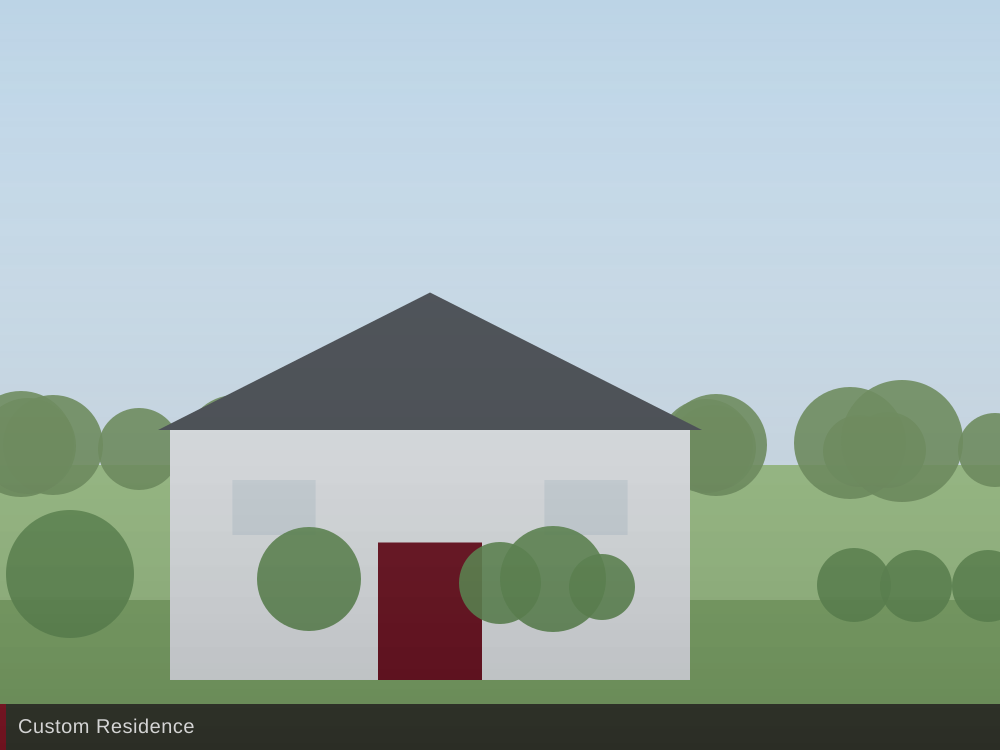

# Avodah Contractors — Website

## v10 revisions (this pass)

### Revision round 4 (latest) — Window 2 carousel → category grid

**`custom.html` + `commercial.html`**

The single-slide carousel is gone, replaced by a static category grid. The
reasoning: this section's job is to let a prospect see the full range and
self-select into it, and a one-at-a-time carousel hid 6 of Custom's 7
categories behind six clicks. It also had no swipe support on mobile and no
arrow-key support, so the only way through was tapping 44px buttons.

- **Grid:** 2 columns on phones → 3 at 600px → 4 at 900px. Custom shows 7
  cards, Commercial 4.
- **4:3 photo frames.** Six of the nine source photos are natively 4:3, so
  cropping went from ~17% (in the old 16/10 frame) to zero for most of them.
- **Labels below the photo**, not overlaid, so legibility no longer depends on
  what's in the image. Category names are real `<h3>` headings now, which the
  overlaid carousel captions were not — a small SEO gain on keyword-relevant
  terms like "Horse Barns" and "Wedding Venues".
- **Whole card is clickable** via a stretched `<button>`, rather than the old
  `<a href="#">` + `preventDefault` link-as-button antipattern.
- **New closing CTA row** spans the last grid line on both pages: "Not sure
  which of these fits?" → Start Your Project. Fills what would otherwise be a
  ragged final row, and gives the section a conversion path it didn't have.
- **One interaction level removed.** It was card → category modal → lightbox.
  Now the card opens the shared lightbox directly on that category's photos,
  with prev/next and arrow keys to move through the set. The per-category
  photo sets live in hidden `.gallery-set` containers.
- **28 thumbnail downloads eliminated** on Custom (7 categories × 4 photos).
  The hidden sets are `display: none`, so their lazy thumbnails never fetch —
  the lightbox reads `data-full` directly.

**Dead code removed** (verified: Custom and Commercial were the only consumers)
- `styles.css`: all `.carousel*` rules, `.gallery-modal*`, `.collage-modal`
  — 127 lines. Now 1425 lines.
- `script.js`: the carousel engine and the spotlight-modal handler — 166 lines.
  Now 329 lines. A `NOTE` comment marks where each was, in both files.

**Bugs found and fixed during this round**
- `grid-template-columns: repeat(2, 1fr)` produced **unequal columns**
  (92.7px / 182.6px) at 320px, because plain `1fr` means `minmax(auto, 1fr)`
  and "Warehouses / Manufacturing" forced its track to its min-content width.
  The tracks then overflowed their container and dragged the full-width CTA
  out with them. Fixed with `minmax(0, 1fr)` plus `overflow-wrap: break-word`
  and `hyphens: auto` on the category name.
- `<div class="ph">` nested inside `<button class="gallery-item">` — invalid
  HTML, pre-existing in the old modal markup. Converted to `<span>` (8
  instances in `commercial.html`). Placeholder rendering verified unaffected.

**Verified after this round:** zero horizontal overflow across all 7 pages × 9
widths; equal grid tracks and contained CTA at all 9 widths on both pages; card
→ lightbox → arrow keys → Escape works, with focus returning to the card rather
than being dropped to `<body>`; `index.html`'s collage lightbox and scroll
animation (238 SVG paths, 5 progressive steps) still work after the shared
`script.js` edits; the all-placeholder Retail and Auto categories still render
labelled frames rather than an empty lightbox.

⚠️ **`commercial.html` is now visibly thin on assets.** With only 4 categories
in a 4-column row, the two placeholder cards (Retail, Auto) sit right next to
the two real ones — the grid makes missing photos more obvious than the
carousel did, since you now see all four at once. Real photos for those two
would help this page more than any further layout work.

---

### Revision round 3

**`about.html`**
- Removed the "On this page" anchor nav and the "Work — dependable, organized,
  committed…" red value bar.
- *Consequence handled:* the red bar had been the only thing separating the
  white hero from the white `#vision` block, and both use the same
  text-left / image-right layout, so they would have merged into one flat slab.
  The five content sections were re-alternated to
  **warm → white → warm → white → warm**, giving a clean rhythm from hero to
  CTA with no two adjacent sections sharing a background. `.proof-card` went
  back to white, since `#reviews` is warm again.
- Dead CSS removed: `.page-toc`, `.page-toc-label`, `.value-bar-flow`.
  `.value-bar` / `.value-bar-thin` were **kept** — `index.html` still uses them.
  The `main section[id] { scroll-margin-top: 96px }` rule was kept too, so any
  already-shared deep link (e.g. `about.html#where`) still lands correctly.

**`custom.html` + `commercial.html` — Window 2 ("What we build") framing**

Both pages' HTML is **byte-identical to v9**; this was fixed entirely in
`styles.css`, so no content changed.

The strange framing had a specific cause: the card frame is
`aspect-ratio: 16/10` (**1.600**), but the source photos run from **1.333**
(the 4:3 shots — 6 of 9) to **2.077** (`warehouses-mfg-carousel.jpg`), and the
image used `object-fit: contain` on a **black** background. So every slide was
letterboxed or pillarboxed, and the black bars jumped from the sides to the top
and bottom as you clicked through — against a black section, which made the
photo look like it was floating in a void.

Fixed by:
- Section background **black → white**.
- `object-fit: contain` → **`cover`**, so every slide fills the frame
  identically with no bars. Verified: on both pages every card's image now
  measures exactly the frame box, at a consistent 1.600 ratio.
- Carousel constrained to **~2/3 of the 1160px content column** (774px at
  desktop) and centred, so white page shows either side. Below ~813px viewport
  it goes full-width inside the normal gutters — two-thirds on a phone would be
  unusably small.
- Dots returned to brand red (the white dots would have vanished on white).
- Nav buttons tucked to a consistent 32px inset from the photo edges.
- Card background black → stone, so nothing flashes black while a photo loads.

⚠️ **Cropping tradeoff:** `cover` crops to fill. Centre-cropping is fine for
these building shots, but the 4:3 photos lose ~17% off top and bottom, and
`warehouses-mfg-carousel.jpg` (2.077) loses ~23% off the sides — worth a
glance to confirm nothing important is cut. If any shot crops badly, either
re-crop that source photo to 16:10 or tell me and I'll change the frame ratio
(3:2 would crop noticeably less overall).

*Note:* `commercial.html`'s carousel still has 2 real photos and 2 `.ph`
placeholders (Retail, Auto). Those placeholders now fill the frame correctly
too, but they still need real photos.

---

### Revision round 2

Applied on top of the v10 rework below.

**`process.html`**
- Removed the "How we price" hero button (the `#pricing` section itself stays).
- Removed the "On this page" anchor nav.
- Removed the three-item red value bar ("One project manager, start to finish…").
- Removed the mid-page red band ("Seen enough of how we work?…").
- *Consequence handled:* removing the value bar and red band left two pairs of
  adjacent white sections. `#faq` is now `.section alt` (warm) so it separates
  from `#pricing`, and the `#stages` heading gained an `<hr class="rule center">`
  — the brand booklet's straight-line buffer, already used in `about.html`'s
  values section — to divide the hero from the stages. No new CSS was needed.
- **`start-a-project.html` is now reachable from this page only via the header
  nav and the closing CTA banner.** That's two routes instead of four; worth
  watching in analytics once conversion tracking is live.

**`about.html`**
- Removed the "Who you'll work with" hero button. *(The matching link in the
  "On this page" nav was kept — only the button was named for removal. Say the
  word if you want the nav gone here too, as it is on Process.)*
- **"What owners say afterward" (`#reviews`) moved below "Where we work"
  (`#where`).** Backgrounds re-alternated to suit: `#where` is now warm,
  `#reviews` white. `.proof-card` changed from white to warm so the review
  cards still read against their new white background.
- **The "Wooster, Ohio" frame is now a Google Map frame.** It uses the same
  keyless `output=embed` iframe pattern already on `contact.html`, so no API
  key is required. The layout is now map (left) + building photo (right),
  equal height; on phones the map leads.
  - To swap for an official embed: Google Maps → the Avodah Contractors
    listing → **Share → Embed a map → Copy HTML**, then replace the `src`.
  - ⚠️ **I could not load google.com from the build sandbox, so the map is
    unverified live.** Open `about.html` in a browser and confirm it renders
    before this goes to Avodah.
  - The address / service area / phone / email chips that were in that frame
    are gone with it. The service-area detail (50-mile radius and the county
    list) was folded into the section intro paragraph so it isn't lost; phone,
    email, and address remain in the footer on every page and on `contact.html`.
    If you want them back as a caption strip under the map, that's a quick add.
- Dead CSS removed: `.local-strip-body` and `.local-facts` are no longer used
  by any page.

*Verified after this round: zero horizontal overflow across 3 pages × 9 widths,
zero JS errors, FAQ ↔ JSON-LD text still matches, all anchors resolve, and
`index.html`'s `.deeper-dive` / `.process-footer` (shared CSS) are untouched.*

---

### The v10 rework

UX rework of **Our Process** (`process.html`) and **Our Culture** (`about.html`),
built against the Foundation Framework. Goal: enough substance to earn trust,
with more routes back to `start-a-project.html`. No other page was touched
except `styles.css` (additive only — see the `v10` block at the bottom).

### Our Process

- **Stage copy rewritten.** The five stage descriptions were photography
  direction notes, not customer copy (e.g. *"Capturing the initial layout,
  heavy machinery, or foundation pour to establish the baseline scale of the
  project"*). They now describe what happens for the owner.
- **Each stage carries three labelled facts** — what you'll walk away with,
  what we need from you, the point of the stage. The Framework's friction
  points are answered here directly (late selections cause delays, changes are
  cheapest during framing, coordination comes off your plate).
- **New: "Why we won't hand you the lowest bid"** (`#pricing`) — a paired
  comparison table. Written as education, not disparagement, per the
  Framework's note that the ideal customer avoids low-bid risk *if properly
  educated*. It also deliberately self-qualifies the anti-customer out.
  **This is the section most likely to need a tone check from Avodah.**
- **New: 9-question FAQ** (`#faq`) using native `<details>`/`<summary>` — no
  JS, keyboard-accessible, closed by default.
- **New: FAQPage JSON-LD** in `<head>`, mirroring the visible FAQ.
- Commitments grid expanded 3 → 6 cards; both dead placeholder embeds removed.
- Added an on-page anchor nav, a red commitments bar, and a mid-page red CTA
  band so the form is reachable before the footer.
- Step 04's placeholder now uses a real photo (`collage/gallery-07.jpg`).

### Our Culture

- **Both `stock-*.svg` placeholders replaced with real photos.** Zero
  placeholder frames remain on this page.
- **Nine values restructured** out of three cramped `<strong>`/`<br>` blocks
  into three scannable groups (`<dl>`) with plain-language commitments.
- **New: "Who'll actually be on your site"** (`#team`) — project manager /
  in-house crews / small set of trade partners.
- **New: Google reviews block** (`#reviews`) and **"Where we work"**
  (`#where`) using `MainLocation.jpg`.
- Added an on-page anchor nav and a "what happens next" block in the CTA.

### ⚠️ Needs Avodah's sign-off before launch

Everything below is plausible but **unverified** — confirm or correct it:

| Claim | Where |
|---|---|
| Counties served: Wayne, Holmes, Ashland, Medina, Stark | `process.html` FAQ #2 + JSON-LD, `about.html` `#where` |
| "$400,000" project floor | `process.html` FAQ #1 + JSON-LD |
| "Twenty minutes" call + site-visit sequence | `next-steps` block on **both** pages |
| "We've helped owners carry furniture in on move-in day" | `process.html` stage 05 |
| Permit handling included | `process.html` stage 02 |
| Renovations yes / standalone painting & framing no | `process.html` FAQ #8 + JSON-LD |

**If you edit any FAQ question or answer, edit the JSON-LD in
`process.html`'s `<head>` to match exactly** — including curly quotes. Google
flags FAQPage markup that differs from visible text. (This bit us once already:
the markup had `"Avodah"` where the page had `“Avodah”`.)

### Still placeholder / to swap

- **Culture hero photo** — currently an in-progress craft shot
  (`collage/gallery-07.jpg`) with honest alt text. A real photo of the Avodah
  team would be much stronger. Search `about.html` for `SWAP:`.
- **Only one real review** is on `#reviews` (Rich Walters, from Google). Two or
  three reads as far stronger proof. There's a copy-paste `<div class="proof-card">`
  template in an HTML comment right below it — **only use reviews Avodah has
  actually received.**

### Recommended next (not done — outside this pass's scope)

1. **The homepage still has the old photo-direction copy.** `index.html`'s
   scroll animation (`.scrolly-box`, five step cards) carries the same
   shot-list text that was just rewritten on `process.html`. Worth syncing so
   the two pages don't contradict each other.
2. **LocalBusiness JSON-LD** for `index.html` / `about.html`. Deliberately
   skipped: publishing structured data with unconfirmed hours, geo, and canonical
   URL is worse than none. Confirm those, then add it.

### QA performed

Playwright, 3 pages × 9 viewport widths (320 / 375 / 480 / 700 / 768 / 860 /
1024 / 1280 / 1440): zero horizontal overflow, zero JS errors. 133 internal
links, anchors, and asset paths all resolve. Three bugs found and fixed that
weren't in any revision doc:

- `.value-bar-thin`'s `white-space: nowrap` (tuned for the shorter homepage
  copy) overflowed the viewport to 814px / 967px at 768px wide. Fixed with an
  additive `.value-bar-flow` modifier — **the homepage bar is unchanged.**
- The email address in `#where` is a ~250px unbreakable token; grid's automatic
  minimum size pushed the track past the container at 320px. Fixed with
  `min-width: 0` + `overflow-wrap: anywhere`.
- The FAQ JSON-LD straight-quote / curly-quote mismatch noted above.

---

## v8 revisions (previous pass)

This round implemented the Round 6 revisions doc (Home / Custom / Commercial).
Highlights:

- **Home** — new hero copy; Custom/Commercial split-photo headings now pin to
  the top of each photo ("Avodah" as a red sub-heading over "Custom" /
  "Commercial"); the process heading now fits on one line at every width;
  the five step cards are outlined from the start and **fill in** left-to-right
  as you scroll (instead of fading up from nothing), the whole animation now
  sits in an outlined frame, and the scroll track is shorter (faster to get
  through); the "Looking for a deeper dive" line is now a full-bleed red band;
  the culture photo has square corners and a new Google-rating quote block
  with a second "Leave a Review" button.
- **Custom / Commercial** — Window 1 is now a condensed photo banner with
  "Avodah Custom" / "Avodah Commercial" and a Home / breadcrumb; the "What we
  build" section is a large photo carousel (cards cycle continuously —
  clicking Prev on the first slide wraps to the last, and vice versa) with
  each category overlaid on its own photo and a **View Gallery** link;
  clicking a card opens a spotlight modal with a small collage of placeholder
  photos for that category, and each of those opens the full-size lightbox.
  The old 9-photo "Project Portfolio" grid + "Show more" button is replaced
  by two side-by-side project case studies, each a 3-photo collage (design
  rendering / in progress / finished build). The old single testimonial
  section is removed, and the closing CTA copy is updated on both pages.

**New placeholder photos needed** (all currently shown as labeled `.ph`
frames, same pattern as the existing `stock-*.svg` placeholders — search each
file for `role="img"` to find every spot):
- Both pages: an intro banner photo (Window 1) and a "what we build" overview
  photo (Window 2 banner).
- `custom.html` carousel: `Estate 1.jpg`, `Homestead 1.jpg`, `Luxury 1.jpg`,
  `Barn 1.jpg`, `LH 1.jpg`, `VR 1.jpg`, `WV 1.jpg`.
- `commercial.html` carousel: `Farm 1.jpg`, `Manufacturing 1.jpg`,
  `Retail 1.jpg`, `Auto 1.jpg`.
- Each category's spotlight modal (`.gallery-modal`) has 4 placeholder
  project tiles — replace with real photos and add a real `data-full` path
  on each `.gallery-item` (see the `stock-*.svg` swap example below).
- Each of the two project-case collages (Window 4) needs 3 photos: a design
  rendering, an in-progress shot, and a finished-build shot.

---

Static 7-page site: vanilla HTML/CSS/JS, no frameworks, no build step.
Open `index.html` in a browser, or drop the folder on any static host
(Netlify, Cloudflare Pages, shared hosting, etc.).

## Files

| File | Purpose |
|---|---|
| `index.html` | Home — video hero, crimson value bar, Custom/Commercial split photos, scrolling process, photo collage, culture band |
| `custom.html` | Avodah Custom — residential, equestrian, design-forward commercial + filtered gallery |
| `commercial.html` | Avodah Commercial — ag, warehouse, retail/auto/medical + filtered gallery |
| `process.html` | Five-stage process, commitments, how-we-price comparison, FAQ (+ FAQPage JSON-LD) |
| `about.html` | Work · Worship · Service culture, nine values, project managers & vetted trade partners, reviews, service area |
| `contact.html` | General contact form + direct info + map placeholder |
| `start-a-project.html` | **Primary conversion page** — full estimate-request form |
| `styles.css` | Single shared stylesheet (brand tokens at the top) |
| `script.js` | Sticky/overlay nav, mobile menu, gallery filters, lightbox, budget slider, demo-form guard. *(The v10 FAQ needs no JS — it uses native `<details>`.)* |
| `images/` | Logo, real project photos, header video, and `images/collage/` (24 gallery photos) |

## 1. Images — what's real vs. placeholder

**Already real (in `images/`):**
- `AvodahLogo_Flat_WhiteStroke.png` — official white-stroke logo, black background knocked out to transparent so it sits on white.
- `custom1.jpg`, `commercial1.jpg` — homepage Custom/Commercial split panels.
- `avodah-header.mp4` / `.webm` / `avodah-header-poster.jpg` — homepage hero video (see §2).
- `process-plan.jpg`, `process-adapt.jpg`, `process-build.jpg`, `process-finish.jpg` — four of the five homepage process-step photos (Design & Budget, Site Prep & Foundation, Structural Framing & Dry-In, Final Closeout & Reveal). **Step 4 (Interior Finishes & Exterior Shell) still needs a photo** — it currently shows a labeled placeholder. Drop a real image in and point step 4's `` at it (replace the `.ph` placeholder `<div>` in `index.html` with an `` like the other steps).
- `images/collage/gallery-01.jpg` … `gallery-24.jpg` — the 24 real photos in the homepage collage (Window 5). Every tile is clickable and opens a spotlight overlay.
- `MainLocation.jpg` — the office/main-location photo in the homepage culture band (Window 6).

**Remaining placeholders (inner pages only):**
The `stock-*.svg` files are on-brand illustrated placeholders used in the
**Custom** and **Commercial** page galleries and a few feature slots (the
build environment had no internet access to pull real stock photos). Replace
each with a real `.jpg`/`.webp` by editing the `src` in the HTML.

```html
<!-- example: a gallery item on custom.html / commercial.html -->

<!-- becomes -->

```

- Keep `loading="lazy"` on everything **below the fold**; omit it on hero imagery.
- Write real, descriptive `alt` text (used for SEO and accessibility).
- **Spotlight / lightbox** is wired site-wide: the homepage collage
  (`.collage-item`) and the inner-page galleries (`.gallery-item`) all open the
  same overlay via a `data-full="images/…"` attribute. When you swap an image,
  update its `data-full` to match (or point it at a higher-resolution version).
- **Still labeled placeholders (intentionally):** the Google Maps, Google
  Reviews, and process-video slots remain captioned `.ph` boxes — those are
  embed targets, not photos. See §5.

**Animated process graphic (Home page — "What it's like to work with us"):**
The five build phases are illustrated by a scroll-driven **isometric** line
drawing (all strokes in brand red `#851625`): a team at a desk, a foundation
pad, a post-and-beam frame, siding + roof, and the finished house with the
owners outside. The SVG lives inline in `index.html`; the animation engine is
the "scrolly" block in `script.js`. As you scroll, each step's card reveals on
the right and **stays** — the list accumulates so all five are shown by the
end, with the drawing on the left. To change pacing, adjust the track height in
`styles.css` (`.scrolly-track { height: 560vh }`). Step copy lives in the
`.scrolly-box` elements. Reduced-motion users get a static, fully drawn scene
with all five cards shown.

**Carousels (What We Build):** the Custom and Commercial "What We Build"
sections are carousels (`[data-carousel]` in `script.js`), showing two cards at
a time on wider screens with prev/next arrows and dots.

**Gallery "show more" (Custom & Commercial Project Portfolio):** galleries show
6 projects, then a `[data-gallery-toggle]` button reveals the rest (items
marked `.is-extra`).

**Contact map:** `contact.html` embeds a Google Maps iframe for Avodah
Contractors LLC. (It renders blank in offline previews but works on any live
server.)

## 2. Header video

The homepage hero background is `images/avodah-header.mp4` (H.264) with a
`.webm` (VP9) fallback and an instant-loading `avodah-header-poster.jpg`
poster frame. The source was optimized from ~54 MB to ~8 MB while keeping
**1080p and 30fps**; audio is stripped (background video is muted) and the
MP4 is `+faststart` so it begins playing before fully downloaded.

To replace it, re-encode your new clip with similar settings, e.g.:
```
ffmpeg -i new.mp4 -an -c:v libx264 -b:v 2200k -maxrate 2600k -bufsize 4400k \
  -vf scale=1920:1080 -r 30 -pix_fmt yuv420p -movflags +faststart out.mp4
```
Users with "reduce motion" enabled, or browsers that block autoplay, see the
poster image instead.

## 3. Connect the forms (required before launch)

Static HTML cannot submit anywhere on its own. Both forms carry a `data-demo`
attribute that shows an alert instead of submitting.

**Recommended — JotForm:**
1. Build the form in JotForm with the same fields
   (project type, budget range, location, timeline, notes, phone, email, has-plans).
2. Publish → Embed → copy the iframe/script embed.
3. Replace the entire `<form data-demo …>…</form>` block in
   `start-a-project.html` (and `contact.html`) with the embed.
4. In JotForm, route notifications: project requests → CRM/sales inbox,
   contact form → appropriate email addresses.

**Alternative:** keep the markup and point it at any form backend
(Formspree, Basin, your CRM's endpoint): set `action` and `method="POST"`,
remove `data-demo`, and give each input a `name` your endpoint expects
(names are already in place).

**Conversion tracking:** fire your GA4 event / Meta `Lead` event on the
form's thank-you page or JotForm's submit callback. The Start a Project
submission is the primary key event.

## 4. Analytics IDs

The `<head>` of `index.html` contains full copy-ready snippets for
**GTM, GA4, and Meta Pixel**, wrapped in one HTML comment. Replace
`GTM-XXXXXXX`, `G-XXXXXXXXXX`, and the pixel ID, then uncomment and copy
the same block into the other six pages (each has a marker comment in its head).
If you use GTM, load GA4/Meta through GTM instead of pasting all three.

## 5. Embeds

Captioned placeholder blocks marked "Embed" are ready to be replaced with real iframes:
- Office location map (Google Maps) — `contact.html`
- Process video + jobsite photography — `process.html`

(The homepage map/reviews blocks were removed when the proof section was cut;
add a Google Reviews widget back wherever you'd like social proof to appear.)

## 6. Fonts

- **Poppins** loads from Google Fonts (primary font per brand standards).
- **Copperplate** (header font) uses the system font stack; on machines without
  it, the letterspaced uppercase fallback keeps the look. For pixel-perfect
  consistency, license a Copperplate webfont and add an `@font-face` rule at the
  top of `styles.css`.
- **Alkaline** (accent script) is licensed; **Caveat** is loaded as a free
  stand-in via the `--font-script` token. Swap it the same way.

## Brand tokens

All colors/typography live as CSS variables at the top of `styles.css`:
red `#851625`, black `#231f20`, white, stone `#e6e5e3` — per the 2024 Brand
Identity Standards.

## Out of scope (by design)

CMS integration, live form backend, photography/videography, logo files.
